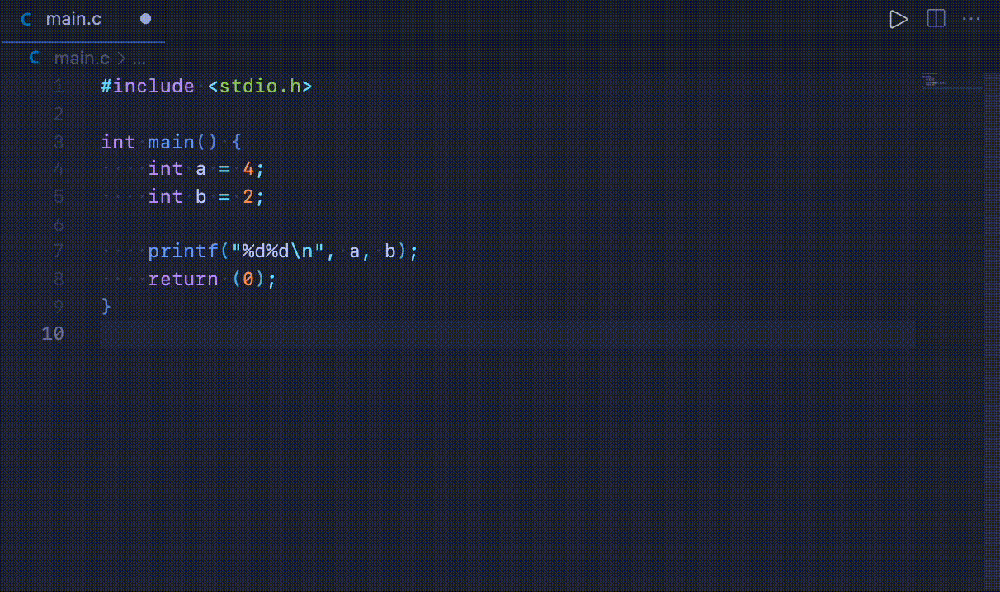

⚠️ If there are any issues with the formatting results, please **file an issue in [dawnbeen/c_formatter_42](https://github.com/dawnbeen/c_formatter_42)** instead of this repository.

# 42 C-Format

42 C-Format is a VScode formatting provider extension for c_formatter_42, which is a c-language formatter that conforms to Norm v3 in 42 schools.

## Features

Provide document formatting using c_formatter_42.



## Usage

- **Installing [`c_formatter_42`](https://github.com/cacharle/c_formatter_42) is required.**

```
$ pip3 install c_formatter_42
$ pip3 install --user c_formatter_42   // if you don't have privilege
```

- Then enable formatting with 42 C-Format, adding configuration as below.

```json
{
    "[c]": {
        "editor.defaultFormatter": "keyhr.42-c-format"
    },
}
```

## Configuration

You can customize the formatter execution by configuring the following settings:

### `42-c-format.executable`

- **Type**: `string`
- **Default**: `"c_formatter_42"`
- **Description**: The executable name or full path to the formatter.

### `42-c-format.args`

- **Type**: `array` of strings
- **Default**: `[]`
- **Description**: Command-line arguments to pass to the formatter.

### Configuration Examples

#### Default Usage (Recommended)

No configuration needed if `c_formatter_42` is installed as a command (e.g., via pipx):

```bash
$ pipx install c_formatter_42
```

#### Run as Python Module

If you installed with pip and want to run as a Python module:

```json
{
    "42-c-format.executable": "python3",
    "42-c-format.args": ["-m", "c_formatter_42"]
}
```

On Windows, use `"python"` instead of `"python3"`:

```json
{
    "42-c-format.executable": "python",
    "42-c-format.args": ["-m", "c_formatter_42"]
}
```

#### Custom Path

Specify a full path to the formatter executable:

```json
{
    "42-c-format.executable": "/usr/local/bin/c_formatter_42"
}
```

## Requirements

- `c_formatter_42` ([GitHub Repository](https://github.com/cacharle/c_formatter_42))

## Contributions

Issues and pull requests are welcomed.

## Release Notes

### 0.1.0

**Breaking Change**: The default execution method has changed from `python3 -m c_formatter_42` to `c_formatter_42` command.

- Added configurable formatter executable path via `42-c-format.executable` setting
- Added configurable command-line arguments via `42-c-format.args` setting
- If you prefer to run as a Python module, please configure the settings as described in the Configuration section
- Improved error handling and timeout management

### 0.0.5

Added windows support.

### 0.0.4

Improved output when catching an error.

### 0.0.3

Added an instruction for installing c\_formatter\_42.

### 0.0.2

Fixed the usage instruction.

### 0.0.1

Initial release.
